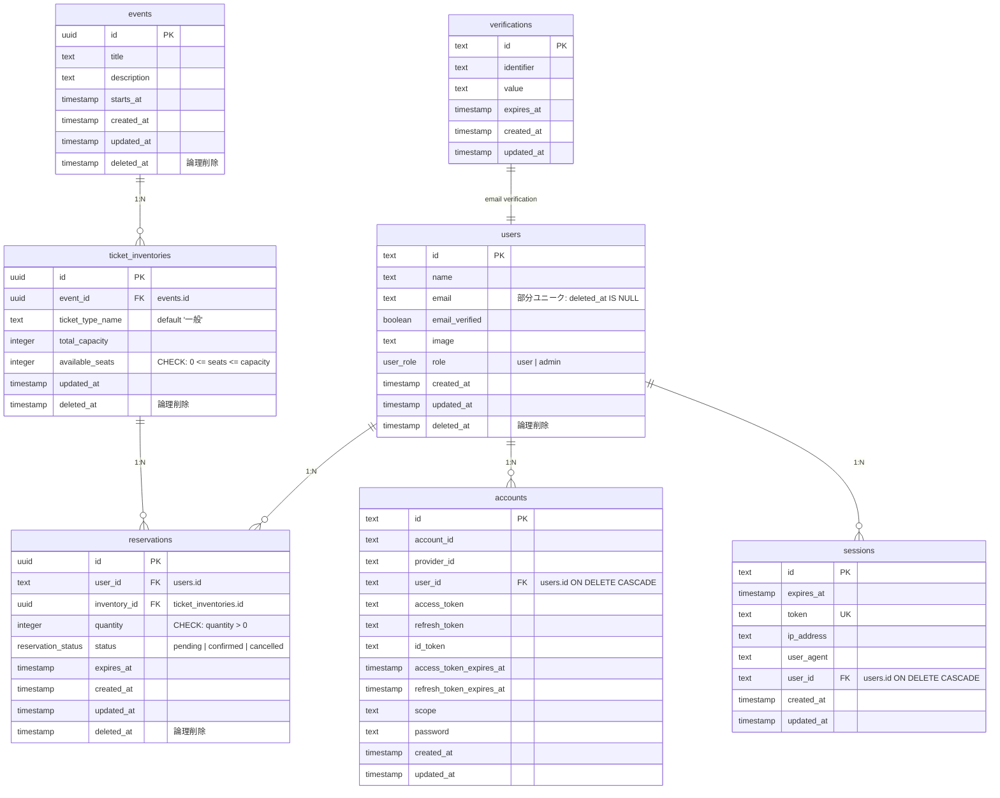

# ER 図

DB スキーマ（`docs/sql.md` / `apps/api/src/db/schema.ts`）の ER 図です。

## 主な制約

| 対象 | 制約 | 目的 |
|---|---|---|
| `users.email` | 部分ユニーク（`deleted_at IS NULL`） | 退会後の再登録を許可 |
| `ticket_inventories.available_seats` | CHECK `>= 0` / `<= total_capacity` | 在庫割れ・過剰返却の最終防衛線 |
| `reservations.quantity` | CHECK `> 0` | 不正な予約数の防止 |
| `reservations (user_id, inventory_id)` | 部分ユニーク（`status != 'cancelled' AND deleted_at IS NULL`） | 二重予約の防止 |

`reservations` への書き込みは必ず `ticket_inventories` の行を先に `FOR UPDATE` でロックしてから行います（デッドロック防止のロック順序統一）。詳細は `docs/sql.md` を参照。
